# Milestone 3: delightful mobile onboarding (motion, haptics, category polish)

This milestone polishes the V3 category screens: warmer headings, a choice that visibly "lands", a sheet that glides away, quiet native haptics and a small completion moment. Every change lives in the shared components that **both** first-time Personalize **and** Explore My Priorities render (`CategoryScreen` → `CategoryStep` → `FeatureCard` / `ImportanceSheet`, from PR #189), so both get it with no second implementation.

**Release safety:**
- `FLH_ONBOARDING_V3` stays **off** by default.
- No migrations.
- No change to Match, scoring, identities, catalogs, tiers, routing, the Explore storage key, Quick Start, or the native welcome and homepage.
- The desktop Feature Library / board is pixel-identical to `main` (§6).

## Screenshots and demo

These come from the dev preview (`/dev/onboarding?flow=v3`). Before = `main`, after = this branch. The dark "N" circle at the bottom left is Next.js's dev-mode indicator; it isn't part of the app. All files, including the screen recording `motion-demo-kitchen-390.webm`, are in [`onboarding-motion-polish-screenshots/`](onboarding-motion-polish-screenshots/).

| | Kitchen | Bathroom | Exterior | Rental Features (Home to Rent) |
|---|---|---|---|---|
| Before | 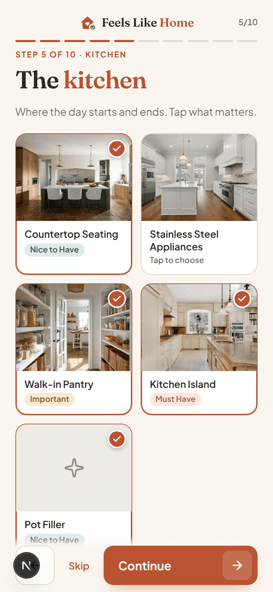 | 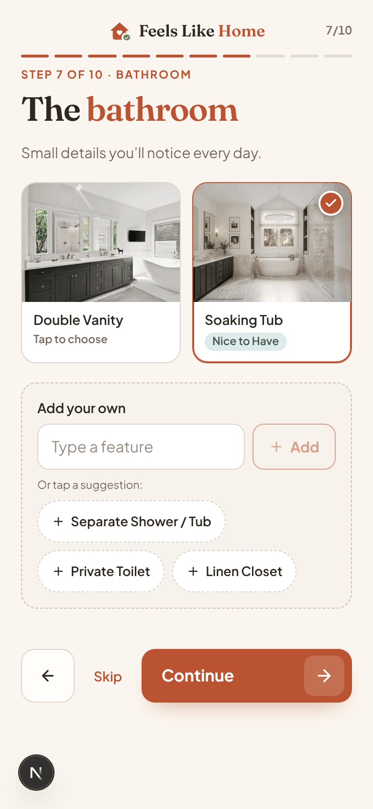 |  | 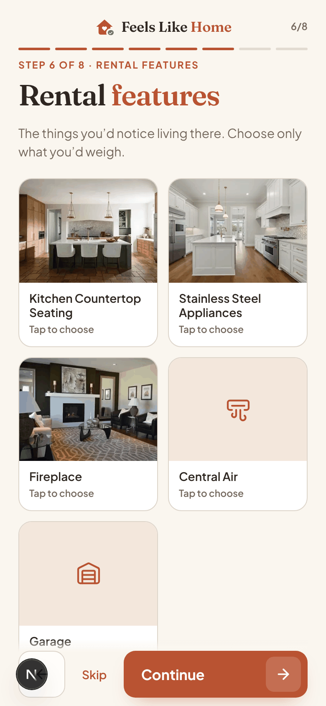 |
| After | 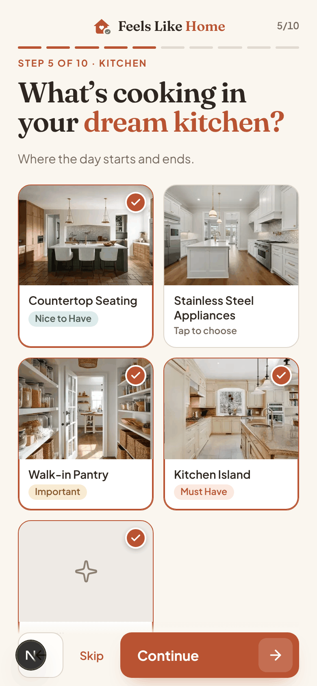 | 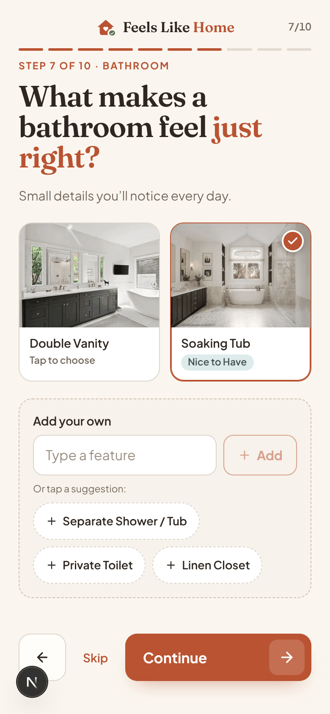 | 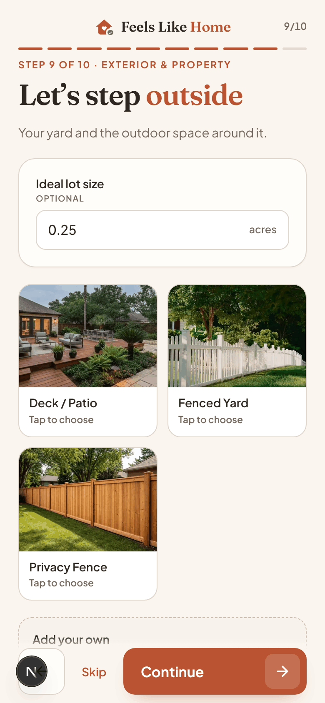 | 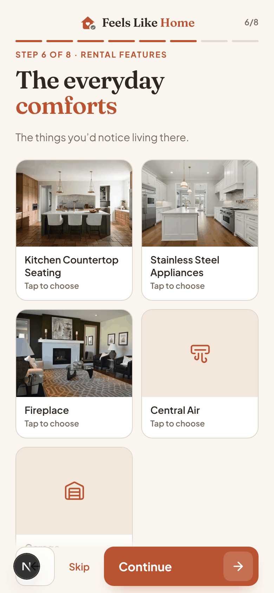 |

There are also before/after shots of Layout, Garage, Neighborhood and the apartment Unit page.

**Motion, frame by frame** (the recording shows it moving):

| Sheet open | Choice landing (sheet sliding away, badge springing) | Landed | Completion on Review |
|---|---|---|---|
| 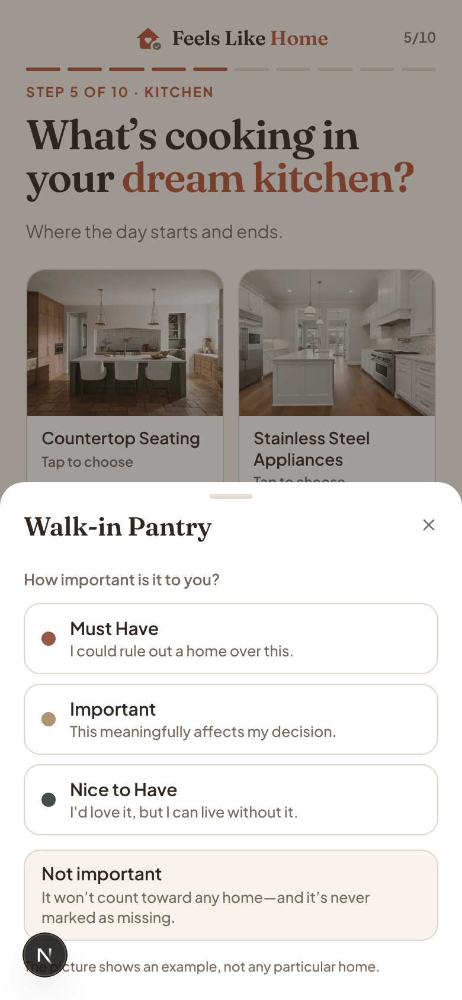 | 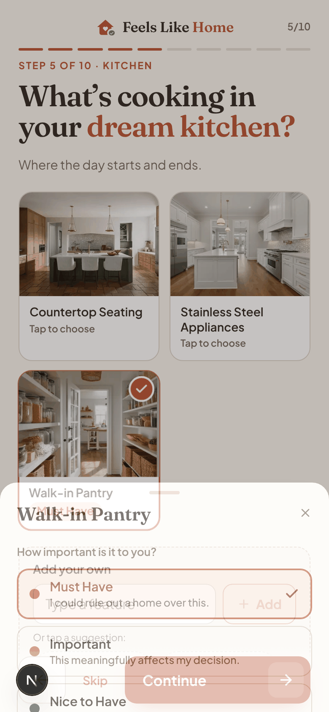 | 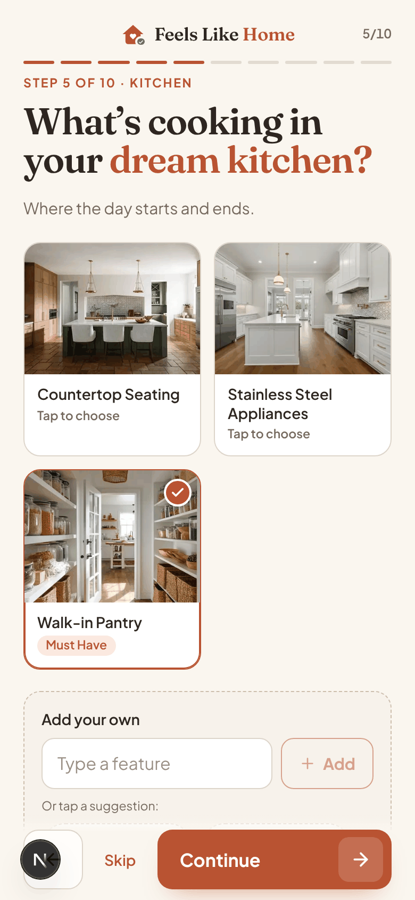 | 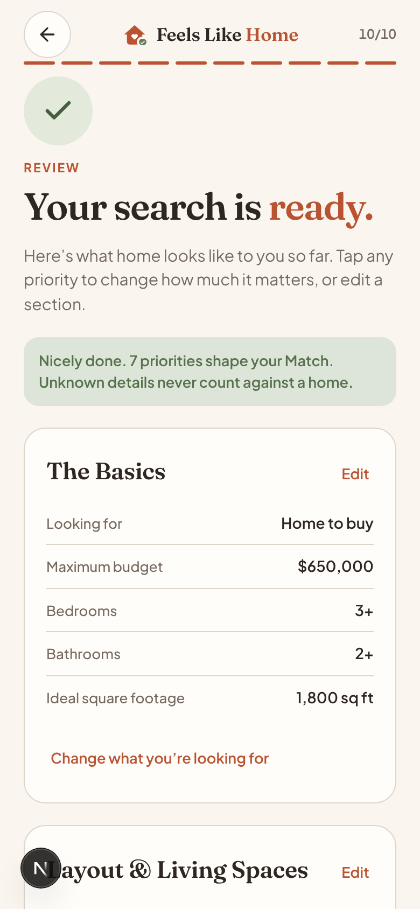 |

## 1. Category copy

Headings are short and conversational, and leads are at most one brief sentence. The "tap what matters" instruction appears once per search type, on its first card screen, and nowhere else. The old repeated "Choose only what you'd weigh" line is gone.

| Category (title unchanged) | Heading | Lead |
|---|---|---|
| Rental Essentials | First, a quick *moving-in question* | Just one—skip it if it doesn't apply. |
| Layout & Living Spaces (buy and rent) | Room for the way *you live* | Tap anything that matters to you. Skip the rest. |
| Kitchen | What's cooking in your *dream kitchen?* | Where the day starts and ends. |
| Living Room | Where you'll *unwind* | The room you'll spend your evenings in. |
| Bathroom | What makes a bathroom feel *just right?* | Small details you'll notice every day. |
| Garage | Let's talk *garage space* | First, how much does a garage matter to you? |
| Rental Features | The everyday *comforts* | The things you'd notice living there. |
| The Unit (apartment) | Behind your own *front door* | Tap anything that matters to you. Skip the rest. |
| The Property (apartment) | The building *and beyond* | What comes with the place you call home. |
| Exterior & Property | Let's step *outside* | Your yard and the outdoor space around it. |
| Location & Neighborhood | What makes a neighborhood feel *like home?* | The street and the area around it. |

Category **titles** are unchanged, so the rail, the Explore index, the eyebrow and the desktop board read as before. The importance words (Must Have / Important / Nice to Have / Not important) and their descriptions are untouched. The approved Home to Buy snapshot (`test/fixtures/v3-home-buy-screens.json`) was updated deliberately, for heading and lead text only.

## 2. Motion (CSS only, no new dependency)

| Moment | What happens | Timing |
|---|---|---|
| Pressing a card, a level, a garage option, a setup-path card or an Explore row | Gentle give, `scale(.97–.98)` | 160ms |
| A level is chosen (or changed) | The card takes a breath (`1 → 1.015 → 1`), and its check and level badge spring in once | 240ms; only when the level changes, never on first render, and it clears after 400ms so it can't loop |
| Importance sheet opens (phones) | Existing 220ms slide-up, plus a backdrop fade | 200ms |
| Importance sheet closes (phones) | Slides back down and the backdrop fades; taps are ignored while it leaves | 180ms (`SHEET_CLOSE_MS`). Focus returns to the card when it's gone. |
| Progress | Segments fill instead of jumping; Explore gets the same slim segmented bar | 250ms |
| End of personalization (Review) | The brand mark becomes a sage check that springs in once, and the summary starts "Nicely done." | 260ms; only when arriving from the last category, never after an edit from Review, when Review is opened directly, or on the desktop board |
| End of a full Explore walk-through | The "every category" note gets a check that springs in once | 240ms; never for a single edit |

Nothing waits on an animation, and nothing loops or pulses.

**Reduce Motion:**
- Every new animation and press transform is disabled.
- The sheet closes instantly.
- The app-wide `prefers-reduced-motion` rule still neutralises anything else.

**The shared `Sheet` primitive** gained one opt-in prop, `closing`. Only the importance picker uses it; every other sheet in the app is unchanged.

## 3. Haptics: exact triggers

All haptics go through `src/lib/haptics.js` (#188). It only calls when the installed binary has the Haptics plugin, and it swallows any failure. So mobile Safari, desktop, older installed builds and a failing haptic engine all behave normally with no errors (tested, §6).

| Trigger | Haptic |
|---|---|
| Choosing an importance in the sheet: Must Have, Important, Nice to Have, or Not important/Remove (onboarding, Explore, Review) | `selectionChanged` |
| Changing the garage importance (not re-tapping the same one) | `selectionChanged` |
| Setup saved and onboarding completed (Review's finish, or Quick Start's finish), fired after `completeOnboarding` succeeds | `impact: LIGHT` |
| Explore → Done, only if something was changed and every save succeeded | `impact: LIGHT` |
| Next, Back, Skip, Continue, screen changes, opening or closing the sheet, garage type, pets answer, scrolling, Explore Done after only looking | **none** |

iOS applies the person's **System Haptics** setting to every one of these natively. Haptics are deliberately *not* tied to Reduce Motion, which is about movement, not touch. Someone who wants no haptics turns off System Haptics. No signing, capabilities, entitlements or bundle IDs were touched.

## 4. Progress and navigation

- **Onboarding:** the existing segmented bar and count, now with a smooth fill. The flow still counts screens, never features.
- **Explore:** the same slim bar under its top bar (Kitchen = 2 of 7), plus the existing eyebrow. "All categories" and "Done" leave at any time.
- **Unchanged:** Back · Skip · Continue/Next, auto-save, resume, and the Personalize and Quick Start paths.

## 5. Data and scoring safety

The only `src/lib` change is category copy (`priorityCategories.js`: `heading` and `lead`). Nothing changes in:
- Match weights or semantics, or JS/SQL parity;
- identities, catalogs or search types;
- tier meaning or co-buyer isolation;
- onboarding completion, Explore storage and resume, Quick Start routing;
- invitation, Realtor and deep-link routing.

No defaults were added: a card still has no level until someone chooses one. Unknown ≠ No; unanswered ≠ Not important.

## 6. Verification

- **Unit tests:** `npm test`: **1,395 pass / 0 fail** (251 database tests skip without Postgres). With real Postgres: **1,644 pass / 0 fail / 2 skipped**. New: `test/onboarding-motion-haptics.test.js` (12 tests). It includes a **real Capacitor fallback test**: `test/support/hapticsScenario.mjs` loads `@capacitor/core` with a simulated iOS bridge in a fresh process and records what reaches native:
  - native with the plugin → exactly `selectionChanged, impact:LIGHT, notification:SUCCESS`;
  - web, and native without the plugin → nothing;
  - a failing engine → no throw and no unhandled rejection.
- **Production build** passes.
- **Motion and haptics browser QA** (`scripts/qa/onboarding-motion-qa.mjs preview`, `main` and branch dev previews): **27/27 checks pass.** "Native" here means a browser emulating Capacitor's injected bridge (real `native-bridge.js` plus plugin headers), not the installed app. It covered:
  - **Sheet and spring:** slide-away under 250ms, one-shot spring that clears;
  - **Exact haptic sequences:** importance ticks; none for Next, Back, Skip or sheet close; garage tick only on change;
  - **Fallbacks:** older-build and no-bridge fallbacks;
  - **Reduce Motion:** instant close, no spring;
  - **Keyboard:** focus into the sheet and back to the card, whose name states the level;
  - **On-screen keyboard (390×420):** Add your own stays visible above the sticky footer, and nothing is preselected;
  - **Widths:** 320/375/390/430 and 200% text (195px) with no overflow, nothing clipped and sheet buttons ≥ 44px;
  - **Completion moment:** appears once; no repeat after an edit or on direct open; no claims;
  - **Desktop board (1440):** pixel-identical to `main` (buy and rent);
  - **Recording:** the motion demo.
- **Real-stack QA** (`… stack`, Supabase stand-in, production build, flag on): **8/8** (`results-stack.json`). It covers the real onboarding with the completion moment and the exact haptic sequence through finish; Explore's Done tap only after an edit; and the Explore progress bar.
- **Existing V3 QA** (`scripts/qa/mobile-priority-onboarding-v3-qa.mjs`): **564/564**. It was updated for #189's setup-path screen (step counts, choosing Personalize) and the new headings. Its keyboard check now waits for the 180ms slide before checking focus.
- **Onboarding visual safety net** (`scripts/visual/onboarding-screens.mjs` capture and compare, `main` vs branch, 480 screenshots across 390/768/1024/1440): **462 identical**. 18 differ by 0.02–0.24%, all glyph anti-aliasing on screens this work doesn't touch (the live flow and the six-step preview); I inspected the diff images and found no layout or colour change.
- **Flag-off and #189 regression:** `scripts/qa/onboarding-paths-qa.mjs` re-run on this branch: **48/48**. That includes both paths, Explore, co-buyer isolation and search switching, plus flag-off pixel identity of My Search (390, 1280), Rank Priorities (390, 1280) and My Homes (1280) against `main`.

## 7. Founder QA: Xcode Simulator and iPhone

Use the worktree and `CAP_SERVER_URL` steps in `docs/native-welcome-share-tutorial.md` §6b, pointed at **this PR's Preview** with `FLH_ONBOARDING_V3=on` set for Preview.

**Simulator** (haptics can't be felt; watch Xcode's console for Capacitor's `To Native -> Haptics` lines):
1. Sign up, pick Home to Buy, then Personalize. On Kitchen, tap a photo card: the sheet slides up. Choose **Must Have**: the sheet glides down, and the badge and check spring in once. The console shows one `Haptics selectionChanged`.
2. Tap Next, Back and Skip: no `Haptics` lines.
3. Garage: pick an importance (one line), then tap the same one again (none).
4. Finish the categories: Review shows the sage check and "Nicely done." Tap **Add my first home**: one `Haptics impact` as you leave.
5. My Search → Explore My Priorities: there's a slim progress bar. Change one thing, then tap **Done**: one `impact`. Open it again and tap Done without changing anything: none.
6. Turn on Settings → Accessibility → Motion → **Reduce Motion**. Nothing slides or springs, and everything still works.
7. Add your own: tap "Type a feature". The keyboard rises and the field stays visible above the Back/Skip/Next bar.

**iPhone** (same build, your Team):
8. Repeat 1–5 and *feel* it: a light tick on each importance choice and one soft tap after saving. Nothing should buzz on navigation.
9. Turn off Settings → Sounds & Haptics → **System Haptics**: no haptics at all, and nothing else changes.
10. VoiceOver: each card reads as "Kitchen Island: Must Have. Choose importance". After choosing, focus is back on the card.
11. Larger Text (Accessibility → Display & Text Size, largest): headings wrap, nothing is cut off, and the footer buttons remain tappable.
12. An older build (if you still have one installed) against this Preview: everything works, just without haptics.
