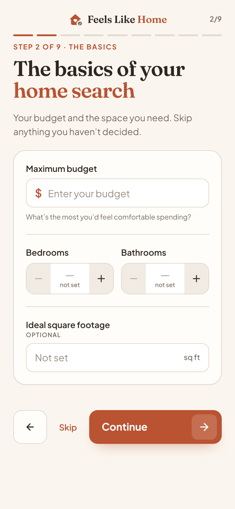
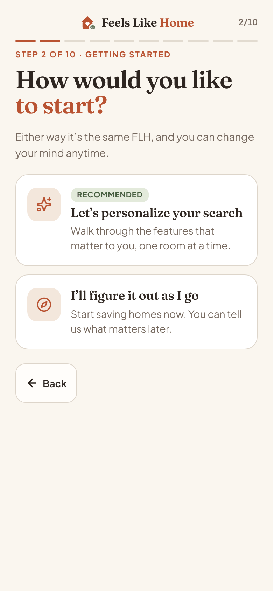
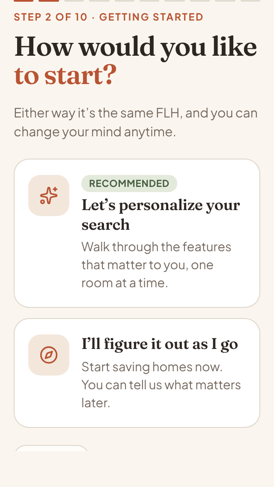
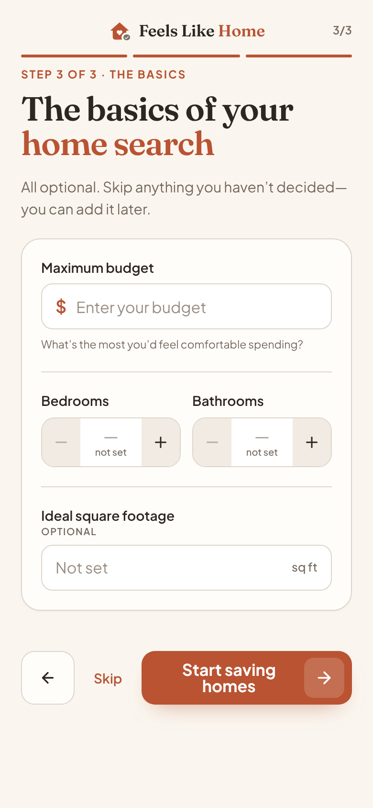
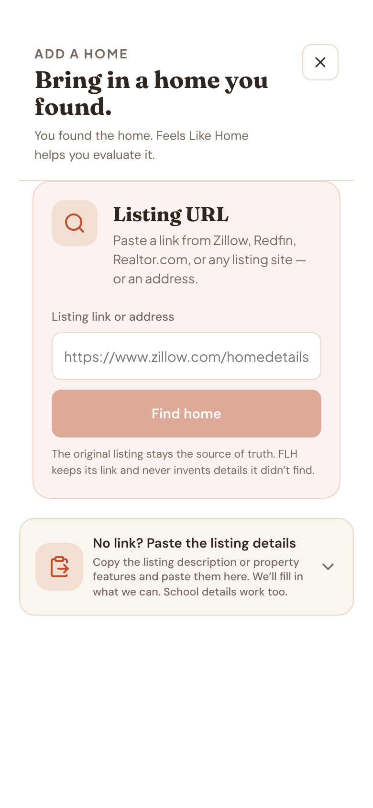
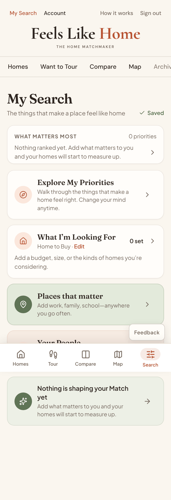
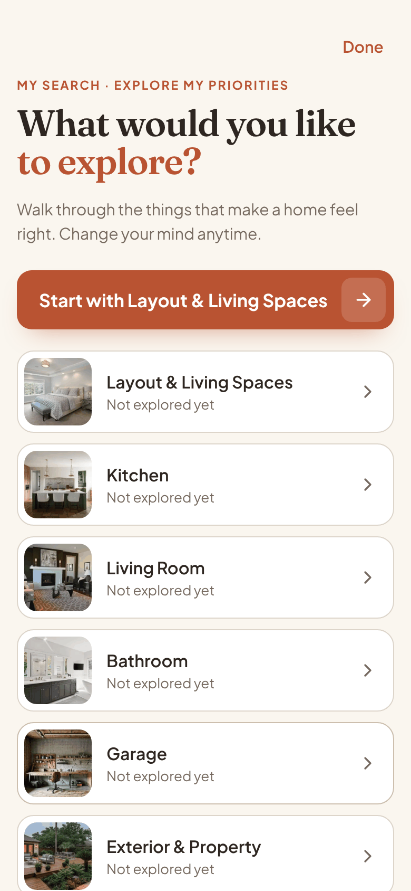
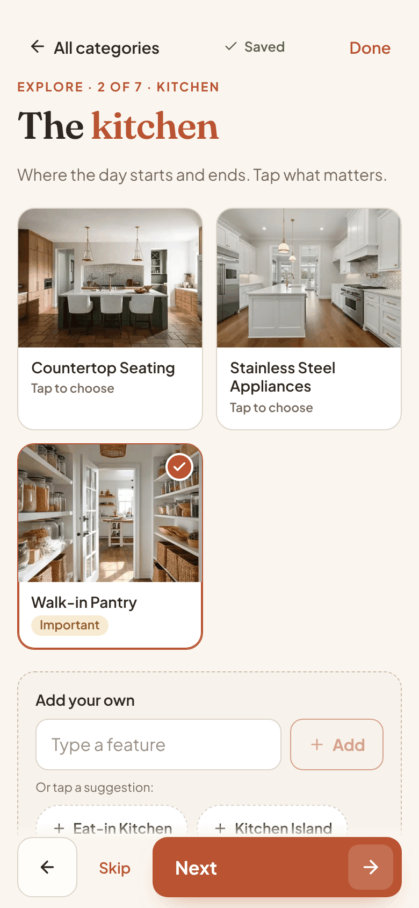

# Milestone 2: two onboarding paths + Explore My Priorities

This milestone gives first-time onboarding two ways to start after the kind of search:

- **"Let's personalize your search"** (recommended), the existing V3 category walkthrough;
- **"I'll figure it out as I go"**, which keeps only optional Basics and then opens Add Home.

It also adds **Explore My Priorities**, a revisitable version of the same category walkthrough reached from My Search.

Everything is behind **`FLH_ONBOARDING_V3`, which stays off by default**. With the flag off, every surface is unchanged; this is verified pixel-for-pixel against `main` (§6). There are no SQL migrations, and Match scoring is unchanged.

This builds on the plan in `docs/native-welcome-share-tutorial.md` §8–§9.

## Screenshots

These are from browser QA (`scripts/qa/onboarding-paths-qa.mjs`). All files are in [`onboarding-paths-explore-priorities-screenshots/`](onboarding-paths-explore-priorities-screenshots/).

**Before (`main`, flag on) → after: the step after the kind of search**

| Before: straight to Basics | After: the setup-path choice | After: 320 × 568 |
|---|---|---|
|  |  |  |

**Quick start → Add Home**

| Optional Basics | Lands in Add Home |
|---|---|
|  |  |

**Explore My Priorities**

| My Search entry | Index | A category, saved | Prefilled on re-entry |
|---|---|---|---|
|  |  |  |  |

## 1. Architecture audit: verified before coding

I checked each claim from PR #188's plan against the code and against real Postgres.

| Claim | Verified |
|---|---|
| Searches are created only by `handle_new_user()` at sign-up; onboarding resolves one and never creates one. | `supabase/schema.sql`; `/onboarding` uses `resolveOnboardingSearch`. The DB test asserts there is exactly one owned search after both paths. |
| Priorities: one document per member per search in `search_member_priorities`, written only by `savePriorities` (an upsert on `(search_id, user_id)`). | `collaboration.js`. RLS rejects a co-buyer writing the owner's row (DB test). |
| Co-buyer answers are independent. | DB and browser QA: a co-buyer edit leaves the owner's row byte-identical. |
| `profiles.onboarding_state` / `_complete` / `_version` hold account onboarding only. | Explore never reads or writes `profiles` (contract test plus a DB before/after comparison). |
| `resolveActiveSearch` / `resolvePriorities` and search switching. | The Explore page uses both, exactly like My Search. AppShell remounts page content per active search, and the DB/browser QA switches searches. |
| `normalizePriorities` keeps unknown top-level keys, and both scorers read named keys only. | Unit test plus a real-Postgres JS = SQL test with and without the new key. |

**Deviations from #188's plan:**

1. **Basics stays on both paths.** It's optional on Quick Start: Continue or Skip finishes. This follows the brief's "search_type → path choice → optional/minimal Basics → finish". Review is not shown on Quick Start, so nothing implies "Not important".
2. **A small data-hygiene fix, required by "no dontcare on Quick Start".** Choosing *Home to Rent* or *Apartment to Rent* on a fresh document used to write `dontcare` for Home to Buy–only features nobody had chosen (for example "Unfenced Yard", "Finished basement"). This was pre-existing behaviour in `switchSearchType`, shared by every flow. It now clears only entries that are actually stored. Absent and `dontcare` already read and score identically for these features: neither is selected, and neither is scored. So this changes no screen and no Match. Garage's explicit "Not important" (its stored `dontcare`) is untouched.
3. **Explore's resume point lives inside the priorities row**, under `priorities.explore = { lastStep, visited[], updatedAt }`, not in a new table. Being in the row makes it per person *and* per search automatically, with no migration and no second store. A Realtor who can read a buyer's priorities row can also see this key; it's harmless (which page they last opened). Both scorers ignore it, proved in JS and SQL (§5).
4. **Flag plumbing for client components.** Instead of threading a prop through every Homes page, the `(app)` layout passes `{ guidedPriorities: onboardingV3Enabled() }` to AppShell, which provides it as a React context (`src/components/FeatureFlags.jsx`). Outside the provider every flag reads as off.

## 2. Part A: two first-time paths

`onboardingFlow.js`, flow 4:

- **The new screen.** `setup_path` comes after `search_type`, and `answers.setupPath` is `personalize | as_i_go`. It's validated, stored only in `onboarding_state`, and never in priorities.
- **Personalize (or unanswered)** keeps exactly the previous screens, order, photos, custom features, garage logic and Review. Each category step and Review now carry `when: personalizing`.
- **Quick start** is `search_type → setup_path → basics → finish`. Leaving Basics (Continue or Skip) runs the existing `finishToDestination`. That saves the document and completes onboarding with the existing services, then opens `pendingRedirect || '/homes?add=1'`, so a pending shared-listing or deep-link destination still wins. Shared-search setup ends on that search's Homes, as before.
- **In-progress sessions:** anyone who has finished a screen after the choice resumes where they were (implicitly Personalize). A fresh start sees the choice.
- **UI** (`PriorityFlow.jsx` → `SetupPathStep`): two large cards with the approved copy. "Recommended" sits on the first, as a quiet badge with no pressure wording. Tapping a card is the one action, and a quiet Back sits beneath. Both cards fit a 320 × 568 screen.

**Match empty state (audit):**

- **No priorities:** `computeMatch` returns `null`. Every surface already shows a no-number message ("Set your priorities…"), never 0%. With the flag on, the My Homes card and the home overlay now say "No Match yet—it starts once you tell FLH what matters" and link to Explore. With the flag off, the copy is byte-identical.
- **Only Basics set:** the percentage is shown with its basis ("Your N% is based on 1 priority"). That is accurate, so it is unchanged. Scoring is untouched.
- **Quick Start with nothing entered:** Match stays `null` for every kind of search (tested).

## 3. Part B: Explore My Priorities

- **Route** `/search/explore`. While the flag is off, `notFound()` shows Next's not-found page inside the app shell; it streams after `(app)/loading.js`, so the HTTP status is 200. It's a focused mobile route, so its own bar and footer replace the app chrome on phones.
- **Data** comes from the same `resolveActiveSearch` + `resolvePriorities` as My Search. Writes go through the same `savePriorities` via `useReliableOptimisticState`, i.e. the participant's own row. It never touches Basics, the kind of search, or onboarding state.
- **Index:** "What would you like to explore?" lists this search's categories with photos and status ("2 chosen", "Nothing chosen yet", "Not explored yet"). It has one primary action: "Pick up at Bathroom", or "Start with …".
- **Category page:** the same `CategoryScreen` as onboarding (same cards, photos, importance sheet, Add your own and garage logic). The eyebrow reads `Explore · 2 of 7 · Kitchen`.
  - **Footer:** Back · Skip · Next / Finish.
  - **Top bar:** All categories · "Saved" status · Done.
- **Saving:** every change saves immediately, so leaving at any moment loses nothing. Done waits for in-flight saves, and stays put with Retry if a save failed. There are no confirmation dialogs.
- **Direct entry:** `/search/explore?category=kitchen` (a key or a step).
- **Resume:** visiting a category records `explore.lastStep`. Revisiting the same page writes nothing.
- **Skip** writes no answer; only the resume point moves (browser QA compares the stored document).
- **My Search:** an "Explore My Priorities" card under What Matters Most, with the brief's copy and "Pick up at …". Quick Edit (Rank Priorities, Basics, Places) is unchanged.

**The reusable adapter (for Milestone 3).** `CategoryScreen` (`PriorityFlow.jsx`) is the single category-page building block, used by both flows. Each flow supplies only navigation (eyebrow, footer callbacks, auto-advance). Milestone 3's transitions, haptics (`src/lib/haptics.js` from #188), headlines and card polish go into `CategoryScreen`/`CategoryStep`/`FeatureCard`/`ImportanceSheet` once and reach both flows, with no second refactor.

## 4. Files

| File | Change |
|---|---|
| `src/lib/onboardingFlow.js` | `setup_path`, `SETUP_PATHS`, `setOnboardingSetupPath`, `isQuickStartState`; personalize-only `when`s; resume past the choice |
| `src/lib/whatMattersCatalog.js` | Clear only stored entries on a search-type switch (§1.2) |
| `src/lib/explorePriorities.js` | New: steps, index, progress, visit, entry helpers |
| `src/components/onboarding/priority/PriorityFlow.jsx` | `CategoryScreen`, `PriorityHeader`, `SetupPathStep`, quick-start Basics label |
| `src/components/onboarding/Onboarding.jsx` | Path choice, quick-start finish |
| `src/components/explore/ExplorePriorities.jsx`, `src/app/(app)/search/explore/page.js` | New |
| `src/components/MySearchPanel.jsx`, `src/app/(app)/search/page.js` | Explore entry card (flag) |
| `src/components/FeatureFlags.jsx`, `AppShell.jsx`, `(app)/layout.js` | Flag context; `/search/explore` focused route |
| `HomesBoard.jsx`, `HomeOverlay.jsx` | Empty-state copy → Explore (flag on only) |
| `src/app/globals.css` | One scoped block |
| Tests | `onboarding-paths-explore-priorities.test.js` (18), `…-db.test.js` (5). Updated pinned step lists and fixture to include `setup_path`, and the focused-routes assertion. |

## 5. Data integrity, co-buyers and Match

- **Existing users:**
  - Finished accounts are never routed to onboarding, and nothing re-runs it.
  - No stored document is migrated or rewritten until the person edits it, and Explore only adds the `explore` key.
  - In-progress V3 sessions resume where they were.
- **Unknown ≠ No; unanswered ≠ Not important.**
  - Skip, Quick Start and unvisited categories write nothing.
  - Tests assert no `dontcare` in any feature tier after Quick Start for all three kinds of search, and after skipping in Explore.
  - Must Have, Important, Nice to Have and Not important keep their existing distinct storage.
- **Co-buyer isolation:** each person edits only their own `(search, user)` row. RLS rejects anything else (real-Postgres test). In browser QA, a co-buyer's Explore edit leaves the owner's row byte-identical.
- **Account state:** Explore never changes `onboarding_complete`, `onboarding_version` or `onboarding_state` (DB before/after equality, in both directions).
- **Match:**
  - JS = SQL Compare parity holds, with and without the `explore` key, which changes neither score (real Postgres).
  - No weights, no household blending, and no scorer file changed.

## 6. Verification

- `npm test`: **1,383 pass, 0 fail** (251 database tests skip without Postgres). With real Postgres: **1,632 pass, 0 fail, 2 skipped**. `next build` passes.
- **Browser QA**, `scripts/qa/onboarding-paths-qa.mjs`: production builds on the Supabase stand-in; the branch with the flag on and off, and `main` with the flag on and off. **48/48 checks pass** (`results.json`):
  - **Personalize:** the full walk-through to Review and finish (Walk-in Pantry Must Have saved; no `dontcare`; one search).
  - **Quick Start:** Skip on Basics lands in Add Home (`/homes?add=1`); profile complete, `as_i_go`; no `dontcare`.
  - **Pending deep link:** Quick Start ends on the shared Zillow listing, not a blank Add Home.
  - **Explore:**
    - entry from My Search, index, Kitchen, "Saved" confirmation;
    - Skip changes no answer; Done persists; onboarding state untouched;
    - "Pick up at Bathroom" on My Search and on the index;
    - onboarding answers prefilled; jump to Kitchen, edit, exit, persisted;
    - an "all done" note after the last category;
    - keyboard focus moves to each page heading.
  - **Co-buyer and search switching:** a co-buyer edits only their row; switching searches loads that search's priorities and resume point.
  - **Entry points:** invitation links (signed out) keep `?redirect=`, and a Realtor isn't sent to onboarding.
  - **Flag off:** live flow for new users, Explore not found, no card; `/search` (390 and 1280), `/search/priorities` (390 and 1280) and `/homes` (1280) are **pixel-identical to `main`**.
  - **Responsive:** 320/375/390/430 with no horizontal overflow and bar/footer controls ≥ 44 px; 200% text has no sideways scroll; Reduce Motion means no sheet slide; no console errors.
- **Not covered here:** a real iPhone or iOS Simulator. Explore on phones uses the same V3 components already device-tested in earlier passes, but please check it in the native shell (§7).

## 7. Founder QA (Preview with `FLH_ONBOARDING_V3=on` for Preview only)

1. Sign up a new account and choose a kind of search. You should see the two cards; pick **Let's personalize your search** and walk through it, choose a few things, then finish.
2. Sign up a second new account and choose **I'll figure it out as I go**. Skip Basics; you should land in **Add Home**. Save a home: no Match % appears until you add priorities.
3. With that account: **My Search → Explore My Priorities → Kitchen**. Choose something, see **Saved**, then tap **Done**. Reopen My Search: it says **Pick up at …**.
4. With the first account, open Explore. Your onboarding answers are already there. Change one, leave, and come back: it's kept.
5. As a co-buyer on a shared search, use Explore. The owner's priorities on My Search don't change.
6. Turn the flag off for Preview, or use Production. Onboarding, My Search and My Homes look exactly as today, and `/search/explore` shows "page not found".
7. In the iOS app pointed at the Preview (`CAP_SERVER_URL`, see `docs/native-welcome-share-tutorial.md` §6b): repeat steps 2–3 on a phone.

**Migrations:** none. **Vercel:** see the PR.
